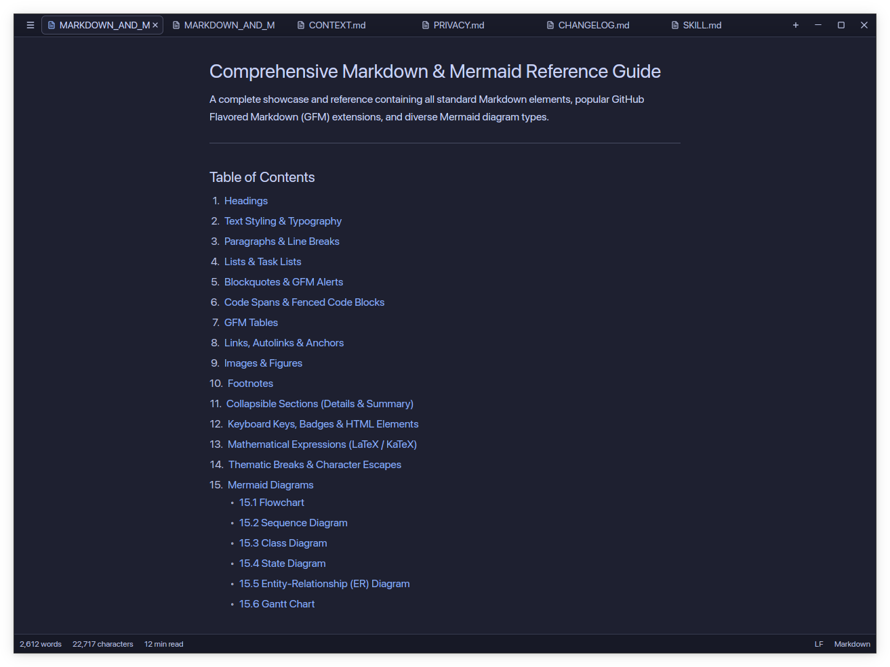
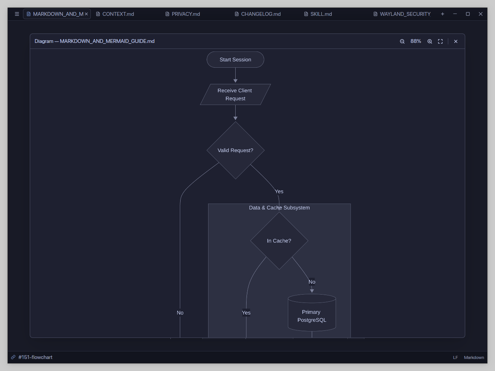
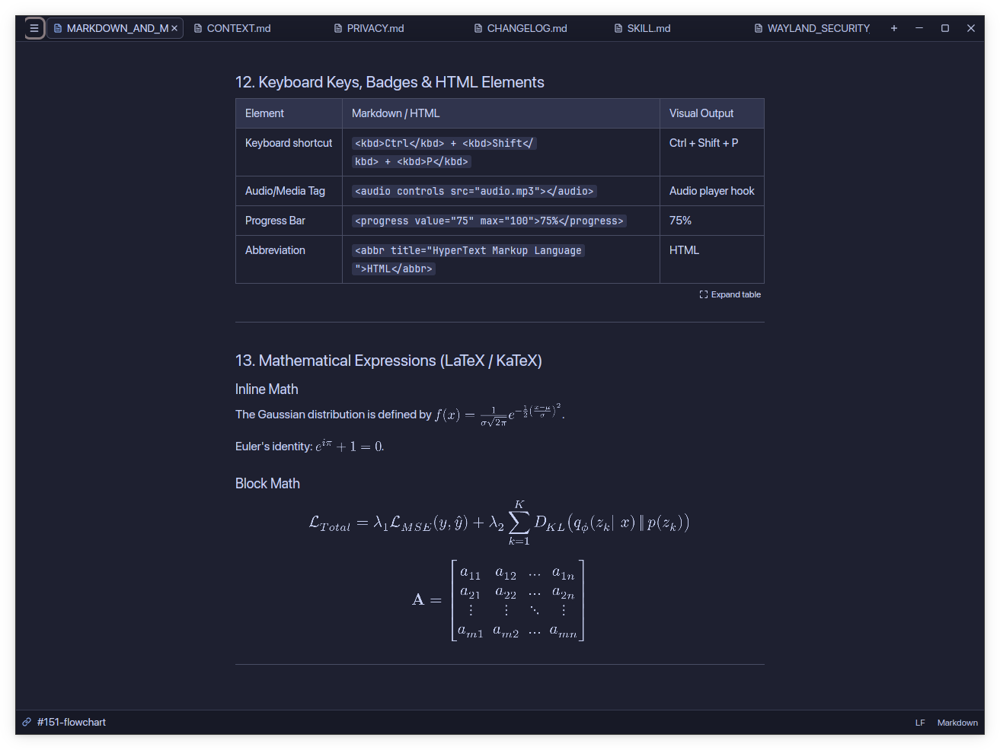
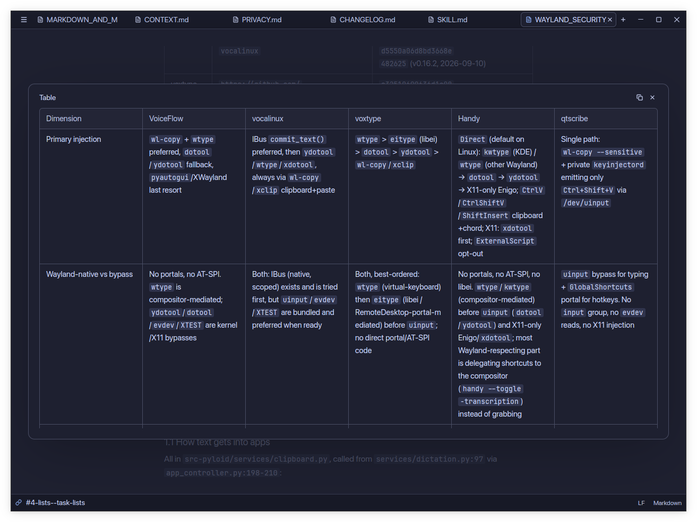
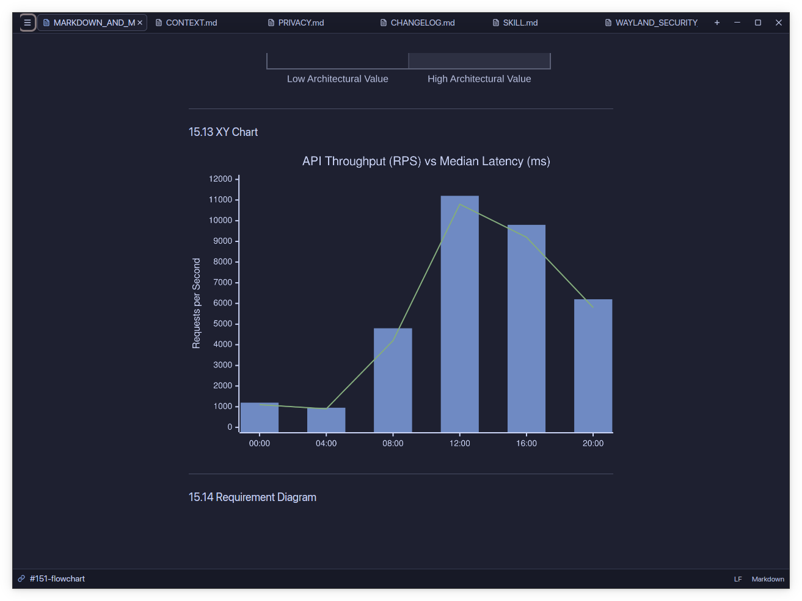

# Downmark

Downmark is a fast, native Markdown editor and previewer built with GPUI for Linux, macOS, and Windows.



## Features

- Split view with synchronized two-way scrolling between editor and preview.
- Native Mermaid diagram rendering with an interactive, zoomable viewer.
- Inline and display LaTeX math equations rendered with Typst.
- Syntax highlighting for 28 languages with code block copy buttons.
- GitHub alert callouts (`[!NOTE]`, `[!TIP]`, `[!IMPORTANT]`, `[!WARNING]`, `[!CAUTION]`).
- Distraction-free focus mode and bundled light and dark themes.

## Screenshots

| Diagram viewer | Math and tables |
| --- | --- |
|  |  |

| Table overlay | Charts and diagrams |
| --- | --- |
|  |  |

## Development setup

### Prerequisites

- A stable Rust toolchain (Rust 1.85 or newer, supporting the 2024 edition):
  ```sh
  curl --proto '=https' --tlsv1.2 -sSf https://sh.rustup.rs | sh
  ```

### Build and run

Clone the repository and build with Cargo:

```sh
git clone https://github.com/Vidhan31/downmark.git
cd downmark
cargo build
```

Run the application:

```sh
cargo run
```

To open a specific file directly:

```sh
cargo run -- path/to/document.md
```

To build an optimized release binary:

```sh
cargo build --release
```

Cargo places the compiled binary at `target/release/downmark` (`downmark.exe` on Windows).

### Testing and validation

Run tests:

```sh
cargo test
```

Run Clippy:

```sh
cargo clippy --all-targets
```

## Credits

Downmark is based on [Malgel](https://github.com/rcawston/Malgel) by [Ross Cawston](https://github.com/rcawston).
