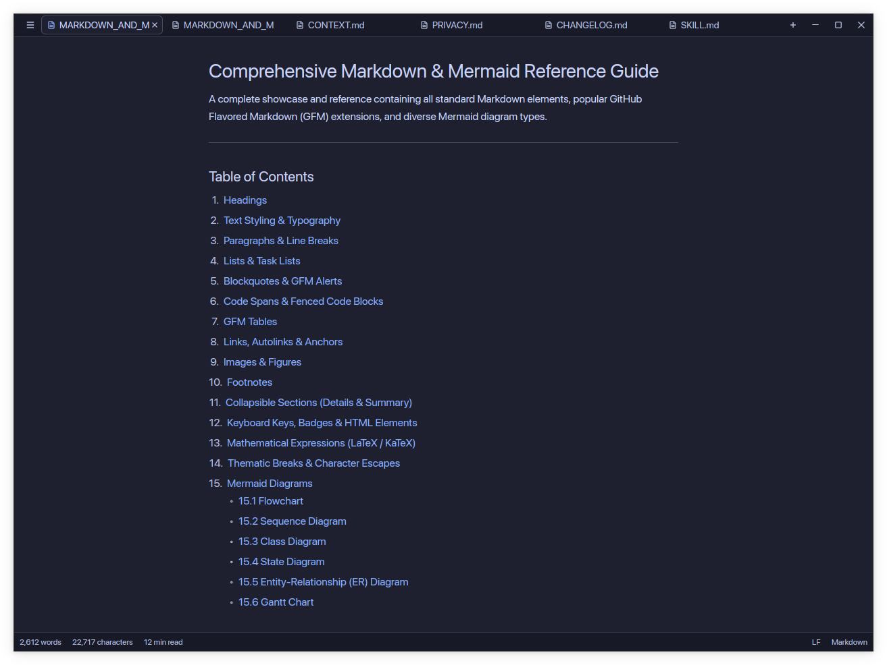
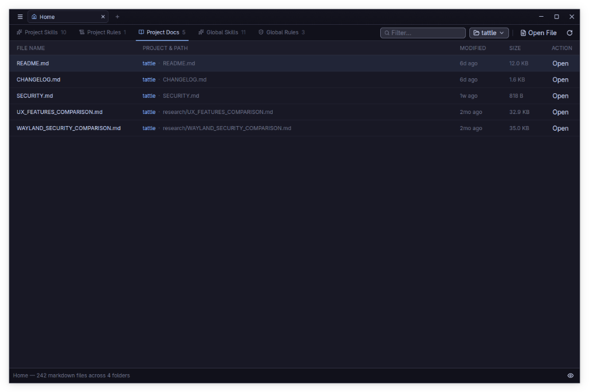
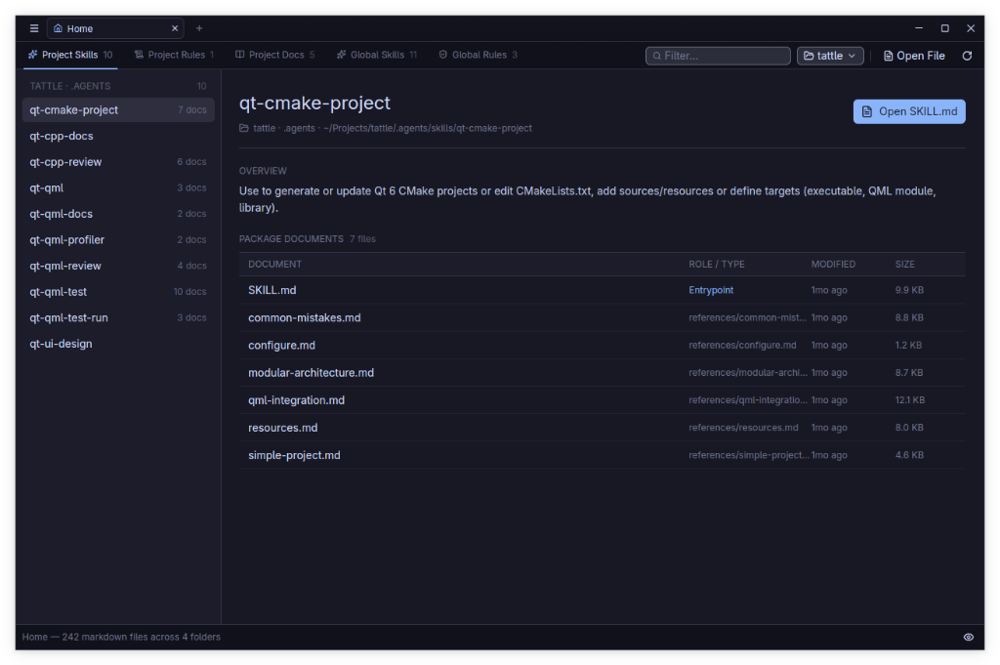
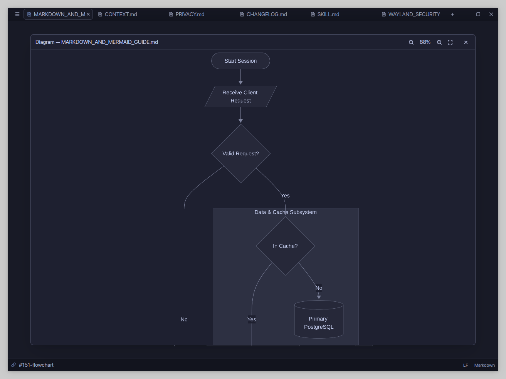
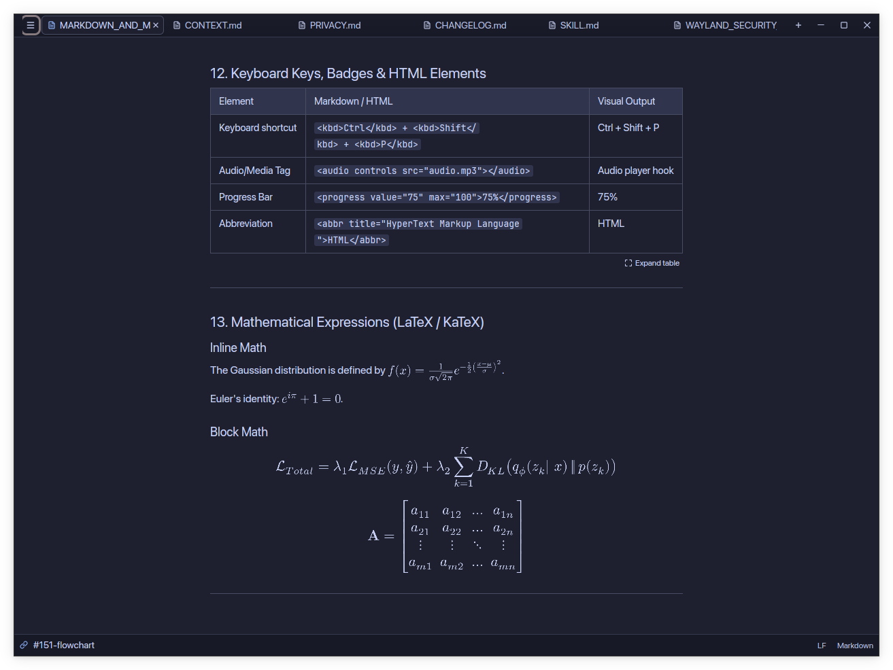
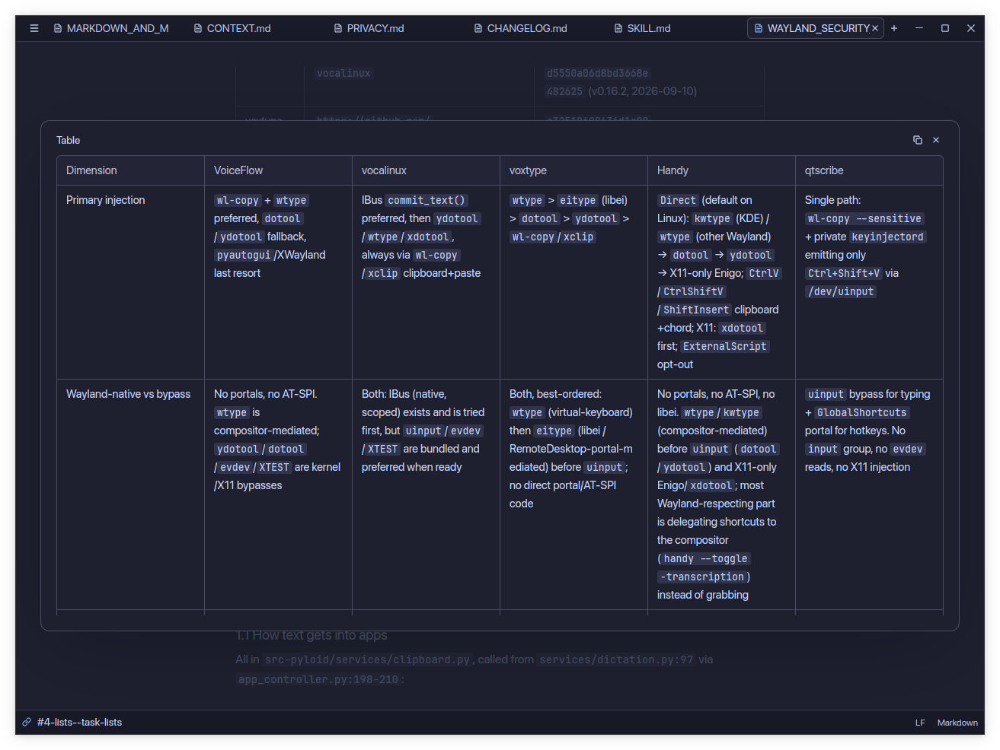
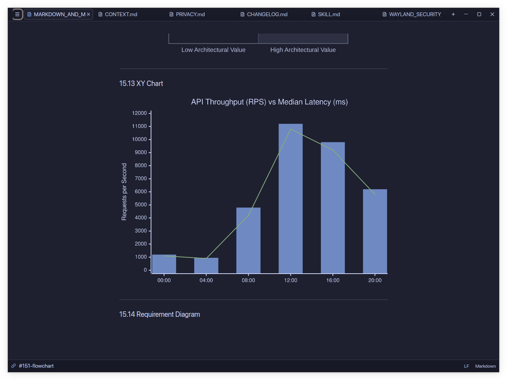

# Downmark

Downmark is a fast, native Markdown viewer and editor built with GPUI for Linux, macOS, and Windows.

Set it as your default Markdown app and open `.md` files with no extra setup. If you work with AI coding agents, the home tab also indexes your project and global skills, rules, and instruction files in one place.



## Features

- Agent workflow hub on the home tab that indexes skills, rules, and Markdown docs across tracked workspaces and global directories for Google Antigravity, Claude Code, OpenAI Codex, Cursor, OpenCode, Windsurf, GitHub Copilot, Amp, Devin, and Kiro, with project filtering.
- Automatic reload when open files or tracked folders change on disk.
- Preview, editor, and split layouts with synchronized two-way scrolling.
- Glance mode for distraction-free reading (`F11` or `Ctrl+Shift+D` / `Cmd+Shift+D`).
- Interactive task list checkboxes in preview mode that update the source file and record undo history.
- Find bar with case-sensitive, whole-word, and regular expression matching, plus scrollbar match markers.
- Native Mermaid diagram rendering with an interactive, zoomable viewer.
- Inline and display LaTeX math equations rendered with Typst.
- Tables with horizontal scrolling, Markdown copy buttons, and an expanded full-width view.
- Syntax highlighting for 28 languages with code block copy buttons.
- GitHub alert callouts (`[!NOTE]`, `[!TIP]`, `[!IMPORTANT]`, `[!WARNING]`, `[!CAUTION]`).
- Copy active file path shortcut (`Ctrl+Shift+C` or `Cmd+Shift+C` on macOS).
- Bundled light and dark themes.

## Screenshots

| Home project docs | Home skill catalog |
| --- | --- |
|  |  |

| Diagram viewer | Math and tables |
| --- | --- |
|  |  |

| Table overlay | Charts and diagrams |
| --- | --- |
|  |  |

## Command-line usage

You can open documents, choose view layouts, and jump directly to specific lines or headings from your terminal.

### Install the terminal command

To add `downmark` to your terminal path on Linux or macOS, open Downmark and select **Help > Install shell command…** (on macOS, **Downmark > Install shell command…**). This creates a launcher in `~/.local/bin` or `/usr/local/bin`. On Windows, the system registers the command alias automatically during package installation.

### Examples

Open one or more documents:

```sh
downmark document.md notes.md
```

Jump directly to a line:

```sh
downmark document.md:42
downmark document.md +42
downmark -l 42 document.md
```

Jump directly to a heading:

```sh
downmark -H "Installation" document.md
```

Start in a specific layout:

```sh
downmark --preview document.md    # Preview only (-p)
downmark --editor document.md     # Editor only (-e)
downmark --split document.md      # Side-by-side split
downmark --glance document.md     # Distraction-free glance mode (-g)
```

Open in a new window instead of reusing an active instance:

```sh
downmark -n document.md
```

View all options:

```sh
downmark --help
```

## Development setup

### Prerequisites

A stable Rust toolchain (Rust 1.98 or newer, supporting the 2024 edition; configured via [rust-toolchain.toml](rust-toolchain.toml)):

```sh
curl --proto '=https' --tlsv1.2 -sSf https://sh.rustup.rs | sh
```

- **Linux:** Install system development libraries required by GPUI, Wayland/X11, TLS, and Vulkan:
  - Debian / Ubuntu: `sudo apt-get install -y libfontconfig-dev libwayland-dev libxkbcommon-x11-dev libx11-xcb-dev libssl-dev libzstd-dev libvulkan1`
  - Fedora: `sudo dnf install -y fontconfig-devel wayland-devel libxkbcommon-x11-devel libX11-devel openssl-devel libzstd-devel vulkan-loader`
- **Windows:** Visual Studio Build Tools with the Windows 10/11 SDK (required for MSVC linking, resource embedding, and MSIX packaging).
- **macOS:** Xcode Command Line Tools (`xcode-select --install`).

Optional local dev tools (installable via [`cargo-binstall`](https://github.com/cargo-bins/cargo-binstall)): `just` (task runner via [Justfile](Justfile)), `prek` or `pre-commit` (Git hooks), `cargo-nextest`, `cargo-deny`, `cargo-machete`, `typos-cli`, and `taplo-cli`.

### Build and run

Clone the repository and build with Cargo:

```sh
git clone https://github.com/Vidhan31/downmark.git
cd downmark
cargo build
```

Run the application:

```sh
cargo run
```

Run with arguments:

```sh
cargo run -- --preview path/to/document.md:25
```

Build an optimized release binary:

```sh
cargo build --release
```

Cargo places the compiled binary at `target/release/downmark` (`downmark.exe` on Windows).

### Testing and validation

Run tests:

```sh
cargo test
```

Run Clippy:

```sh
cargo clippy --all-targets
```

## Credits

Downmark is based on [Malgel](https://github.com/rcawston/Malgel) by [Ross Cawston](https://github.com/rcawston).
