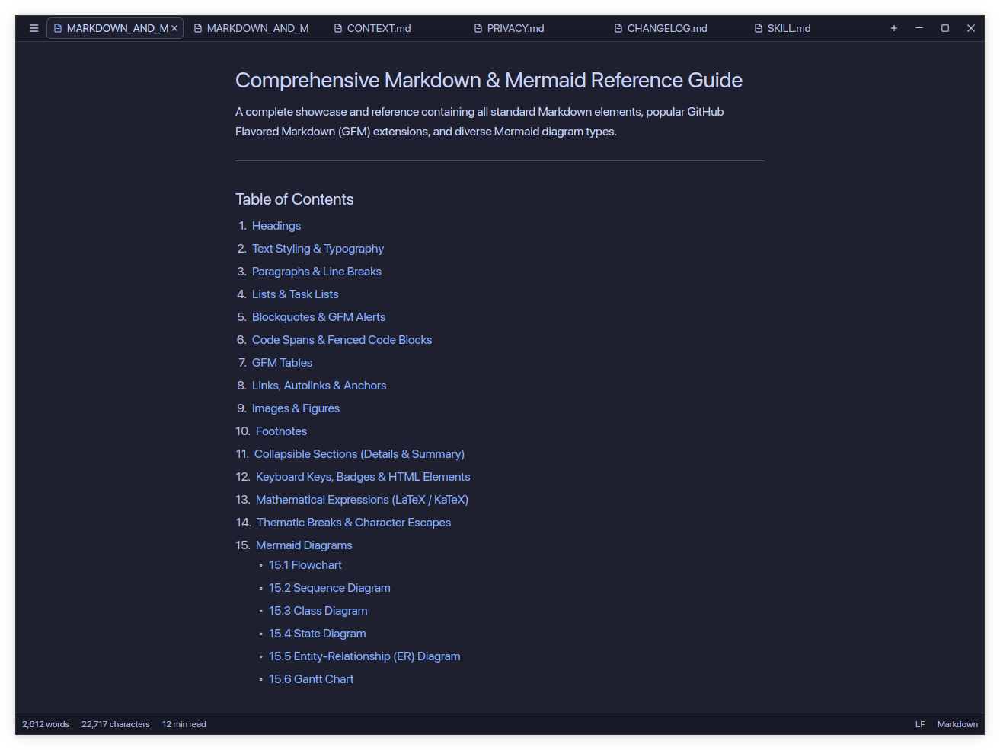
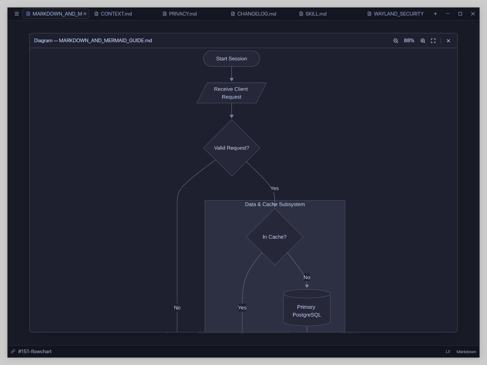
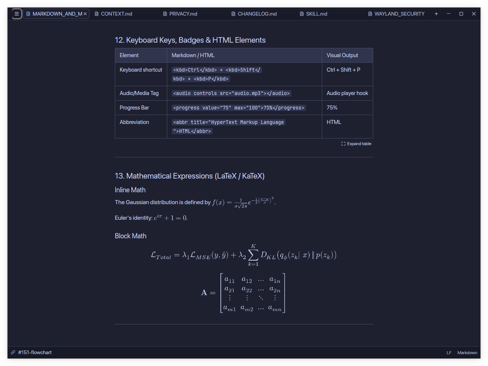
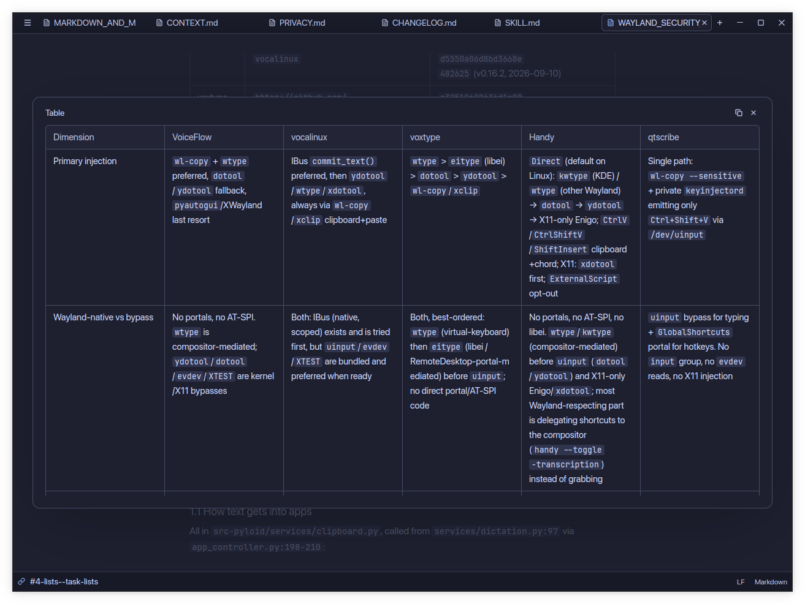
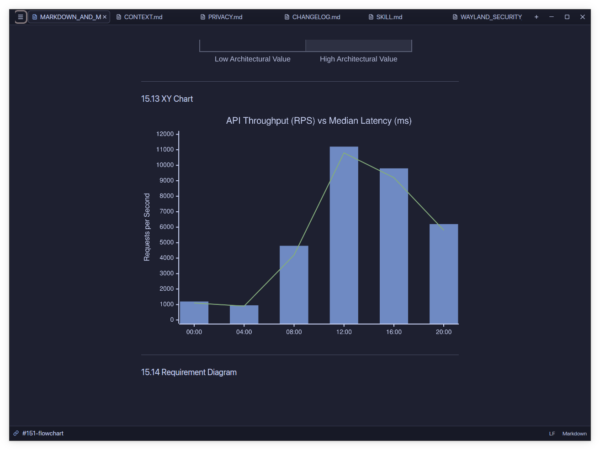

# Downmark

Downmark is a fast, native Markdown editor and previewer built with GPUI for Linux, macOS, and Windows.



## Features

- Split view with synchronized two-way scrolling between editor and preview.
- Preview, editor, and split layouts.
- Glance mode for distraction-free reading (F11 or Ctrl+Shift+D / Cmd+Shift+D).
- Native Mermaid diagram rendering with an interactive, zoomable viewer.
- Inline and display LaTeX math equations rendered with Typst.
- Tables with horizontal scrolling, Markdown copy buttons, and an expanded full-width view.
- Syntax highlighting for 28 languages with code block copy buttons.
- GitHub alert callouts (`[!NOTE]`, `[!TIP]`, `[!IMPORTANT]`, `[!WARNING]`, `[!CAUTION]`).
- Tab strip for multiple open documents.
- Single-instance window reuse that brings your existing window forward and opens new files in tabs.
- Bundled light and dark themes.

## Screenshots

| Diagram viewer | Math and tables |
| --- | --- |
|  |  |

| Table overlay | Charts and diagrams |
| --- | --- |
|  |  |

## Command-line usage

You can open documents, choose view layouts, and jump directly to specific lines or headings from your terminal.

### Install the terminal command

To add `downmark` to your terminal path on Linux or macOS, open Downmark and select **Help > Install shell command…** (on macOS, **Downmark > Install shell command…**). This creates a launcher in `~/.local/bin` or `/usr/local/bin`. On Windows, the system registers the command alias automatically during package installation.

### Examples

Open one or more documents:

```sh
downmark document.md notes.md
```

Jump directly to a line:

```sh
downmark document.md:42
downmark document.md +42
downmark -l 42 document.md
```

Jump directly to a heading:

```sh
downmark -H "Installation" document.md
```

Start in a specific layout:

```sh
downmark --preview document.md    # Preview only (-p)
downmark --editor document.md     # Editor only (-e)
downmark --split document.md      # Side-by-side split
downmark --glance document.md     # Distraction-free glance mode (-g)
```

Open in a new window instead of reusing an active instance:

```sh
downmark -n document.md
```

View all options:

```sh
downmark --help
```

## Development setup

### Prerequisites

A stable Rust toolchain (Rust 1.85 or newer, supporting the 2024 edition):

```sh
curl --proto '=https' --tlsv1.2 -sSf https://sh.rustup.rs | sh
```

### Build and run

Clone the repository and build with Cargo:

```sh
git clone https://github.com/Vidhan31/downmark.git
cd downmark
cargo build
```

Run the application:

```sh
cargo run
```

Run with arguments:

```sh
cargo run -- --preview path/to/document.md:25
```

Build an optimized release binary:

```sh
cargo build --release
```

Cargo places the compiled binary at `target/release/downmark` (`downmark.exe` on Windows).

### Testing and validation

Run tests:

```sh
cargo test
```

Run Clippy:

```sh
cargo clippy --all-targets
```

## Credits

Downmark is based on [Malgel](https://github.com/rcawston/Malgel) by [Ross Cawston](https://github.com/rcawston).
